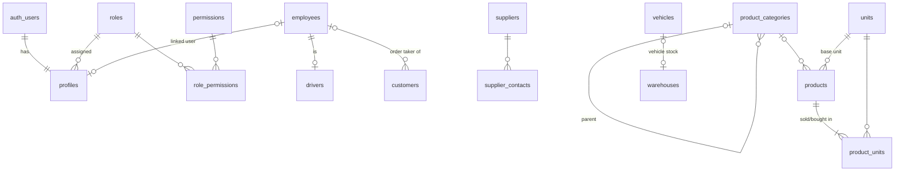
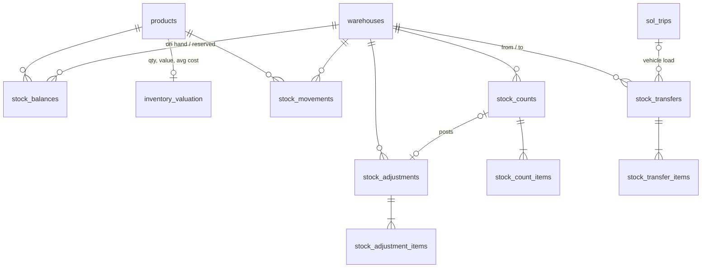
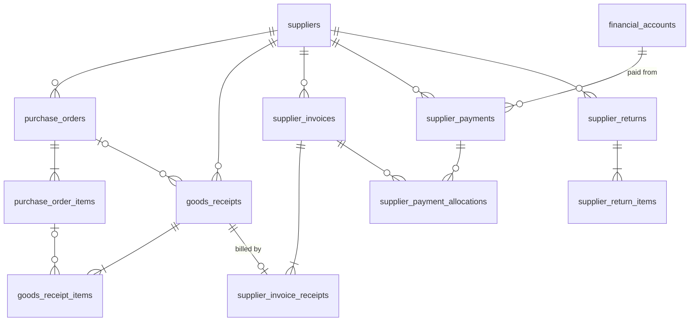
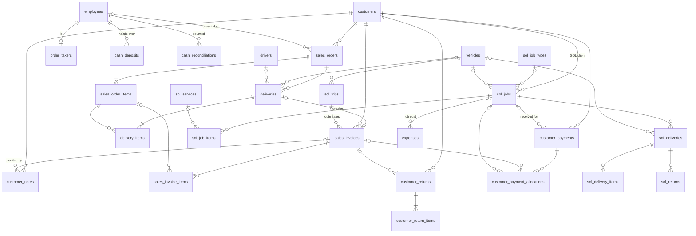
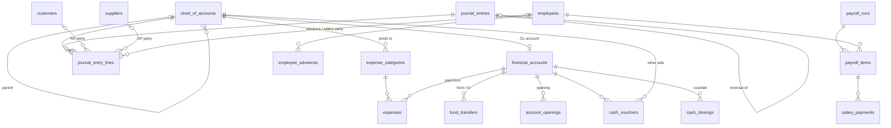

# Database Design

> **Status:** implemented as migrations in `supabase/migrations/` and verified by 245 automated tests on PostgreSQL 17 (`npm run test:db`). See [SUPABASE_SETUP.md](SUPABASE_SETUP.md).

## Conventions

| Topic | Rule |
|---|---|
| Keys | `uuid` primary keys (`gen_random_uuid()`); ledgers use `bigint` identity for strict ordering |
| Money | `numeric(18,2)`; unit prices/costs per unit `numeric(18,2)`; average cost `numeric(18,6)` |
| Quantities | `bigint` in the product's **base unit** (usually pieces). Line tables keep the entered unit, quantity and a snapshot of the conversion `factor`; `base_quantity` is a generated column |
| Documents | `doc_no` from `document_sequences` (e.g. `INV-000123`), gap-free; `status` changes only through posting functions |
| Idempotency | `client_request_id uuid unique` on documents a client might submit twice |
| Audit columns | `created_at/by`, `updated_at/by` maintained by defaults and triggers |
| Schemas | `public` (exposed through the Supabase API), `private` (helpers, never exposed) |

## Migrations

| File | Contents |
|---|---|
| `…100000_foundation` | `private` schema, enums, document numbering, settings, audit log |
| `…100100_identity_access` | employees, roles, permissions, profiles (linked to `auth.users`), permission helpers |
| `…100200_master_data` | customers, suppliers (+contacts), units, categories, products, product units, vehicles, drivers, warehouses |
| `…100300_accounting` | chart of accounts, cash/bank accounts, accounting periods, journal, fund transfers |
| `…100400_inventory` | stock balances, valuation, movements, adjustments, counts, transfers, `move_stock` engine |
| `…100500_purchasing` | purchase orders, goods receipts, supplier invoices, supplier payments/allocations, supplier returns |
| `…100600_sales` | sales orders, deliveries, sales invoices, customer returns, customer payments/allocations |
| `…100700_sol` | SOL transport jobs, SOL vehicle trips, job payment allocation |
| `…100800_expenses_payroll` | expense categories, expenses, employee advances, payroll runs/items, salary payments |
| `…100900_reporting` | ledger, balance, outstanding and profitability views; trial balance; profit and loss |
| `…101000_security` | RLS policies, column privileges, audit/updated triggers, storage buckets |
| `…101100_reference_data` | permissions, roles, units, chart of accounts, expense categories, numbering, settings, default warehouses, Ayra company |
| `20261124100000_access_control` | Super Admin / Manager / Data Entry / Viewer roles, company-account and costs permissions, user lifecycle functions, manager limit, confidential column restrictions and `secure_*` views, salary and bank-detail tables, employee codes |
| `20261124110000_explicit_grants` | explicit table grants (projects that do not expose tables automatically) |
| `20261124120000_dashboard` | dashboard functions |
| `20261125100000_inventory_procurement` | brands, product details and images, receiving with damaged and rejected quantities, closing orders, save functions for every document, negative-stock override, stock-count guard, reports, Pakistan business day for document dates |
| `20261126100000_sales_distribution` | customer details and notes, order takers, order workflow with picking, delivery confirmation with returns, held cash, deposits and counts, customer statement, sales reports, assigned-customer access |
| `20261127100000_sol_vehicles` | SOL job types, services, items, deliveries, returns and payments; vehicle details, drivers list; expenses of jobs and vehicles; account list with masked numbers; reports. Its first section completes databases that received an early copy of the Phase 7 file |
| `20261128100000_finance` | expense approval and categories, payroll, opening balances, vouchers, daily cash closing, period closing, ledgers, statements and ledger checks |
| `20261129100000_documents` | letterhead settings; what each printed document says (`document_data`, `document_statement`), read as the caller |
| `20261130100000_reports` | `reports.export`, `cash_bank.reconcile`; business reports from posted entries, `ledger_total` to compare with, recorded exports, bank reconciliation |
| `20261201100000_distributor` | wording of a distributor; SOL orders of other distributors: `purchase_orders.sol_job_id`, price paid to Ayra as cost of the order |
| `20261202100000_suppliers` | suppliers as staff, supplier and money of a delivery, extra payments to the Ayra company, vendors |

With every new migration, set `app_settings.schema_version` and update `src/config/database.ts` (a test enforces it). Until that migration has been applied, administrators see a notice naming the file and affected pages say the database needs an update.

## Table catalogue

**Identity & system:** `profiles`, `roles`, `permissions`, `role_permissions`, `employees`, `employee_salaries` (confidential), `app_settings`, `document_sequences`, `audit_logs`
**Catalog:** `units`, `product_categories`, `brands`, `products`, `product_units`
**Parties:** `customers`, `suppliers`, `supplier_contacts`
**Fleet:** `vehicles`, `drivers`
**Inventory:** `warehouses`, `stock_balances`, `inventory_valuation`, `stock_movements`, `stock_adjustments(+_items)`, `stock_counts(+_items)`, `stock_transfers(+_items)`
**Purchasing:** `purchase_orders(+_items)`, `goods_receipts(+_items)`, `supplier_invoices`, `supplier_invoice_receipts`, `supplier_payments`, `supplier_payment_allocations`, `supplier_returns(+_items)`
**Sales:** `order_takers`, `customer_notes`, `cash_deposits`, `cash_reconciliations`, `sales_orders(+_items)`, `deliveries`, `delivery_items`, `sales_invoices(+_items)`, `customer_returns(+_items)`, `customer_payments`, `customer_payment_allocations`
**SOL:** `sol_job_types`, `sol_services`, `sol_jobs`, `sol_job_items`, `sol_deliveries`, `sol_delivery_items`, `sol_returns`, `sol_return_items`, `sol_trips`
**Finance:** `chart_of_accounts`, `financial_accounts` (cash + bank), `financial_account_bank_details` (confidential), `accounting_periods`, `journal_entries`, `journal_entry_lines`, `fund_transfers`, `account_openings`, `cash_vouchers`, `cash_closings`, `bank_reconciliations`, `company_extra_payments`, `bank_reconciliation_lines`, `expense_categories`, `expenses`, `employee_advances`, `payroll_runs`, `payroll_items`, `salary_payments`

Requested items that are **views or roles rather than tables**:
- *Ayra company ledger* → `v_company_ledger` (journal lines on control account `AP_PRINCIPAL`)
- *Supplier / customer ledgers* → `v_supplier_ledger`, `v_customer_ledger` (+ balances views)
- *SOL payments* → customer payments allocated to a job (`customer_payment_allocations.sol_job_id`), summarised in `v_sol_job_summary`
- *Cash accounts / bank accounts* → one table `financial_accounts` with `account_type`

## Entity relationship diagrams

### Identity, parties and catalog

### Inventory

### Purchasing and payables

### Sales, receivables and SOL

### Finance

Every posting document also references the `journal_entries` row it created (`journal_entry_id`); omitted above for readability.

## Document lifecycle

Clients insert and edit **drafts** directly (RLS + column privileges). Every state change is a database function that locks the document, validates, moves stock, posts the journal and sets the status in one transaction.

| Function | Effect |
|---|---|
| `approve_purchase_order`, `cancel_purchase_order` | PO status |
| `post_goods_receipt` | Stock in at line value; Dr Inventory / Cr payable (Ayra company or supplier) |
| `post_supplier_invoice` | Matches receipts; posts any price difference to inventory variance |
| `post_supplier_payment`, `allocate_supplier_payment`, `void_supplier_payment` | Payables, partial payments |
| `post_supplier_return` | Stock out at average cost; payable reduced by agreed credit |
| `save_sales_order`, `submit_sales_order`, `send_back_sales_order`, `approve_sales_order`, `start_picking`, `cancel_sales_order`, `close_sales_order` | Approval reserves stock and checks credit limit |
| `dispatch_delivery`, `complete_delivery` | Dispatch creates + posts the sales invoice and releases the reservation; completion posts goods brought back |
| `post_sales_invoice` | Direct (counter/vehicle) invoices |
| `post_customer_return` | Stock back at original cost (damaged → quarantine); credit note |
| `save_customer`, `record_customer_note`, `void_customer_note` | Customers, opening balances, credit and debit notes |
| `record_cash_deposit`, `post_cash_deposit`, `void_cash_deposit`, `reconcile_collector_cash` | Cash with order takers |
| `record_customer_payment`, `settle_invoices`, `post_customer_payment`, `allocate_customer_payment`, `allocate_payment_to_sol_job`, `void_customer_payment` | Receivables, partial payments |
| `post_stock_adjustment`, `post_stock_count`, `post_stock_transfer` | Opening stock, write-offs, count differences, transfers |
| `save_sol_job`, `set_sol_job_status`, `complete_sol_job`, `reopen_sol_job`, `cancel_sol_job`, `close_sol_trip` | SOL jobs |
| `save_sol_delivery`, `dispatch_sol_delivery`, `complete_sol_delivery`, `return_sol_goods`, `cancel_sol_delivery` | SOL deliveries and stock |
| `record_sol_payment`, `release_sol_payment`, `record_expense` | Job payments and costs |
| `record_expense`, `update_expense`, `post_expense`, `reject_expense`, `void_expense`, `attach_expense_receipt` | Expenses |
| `prepare_payroll`, `save_payroll`, `post_payroll_run`, `pay_salaries`, `record_advance` and their `void_…` | Payroll |
| `record_account_opening`, `record_fund_transfer`, `record_cash_voucher` and their `void_…`; `close_cash_day`, `reopen_cash_day` | Cash and bank |
| `create_period`, `period_checklist`, `close_period`, `reopen_period` | Periods |
| `general_ledger`, `account_book`, `list_journal`, `report_trial_balance`, `income_statement`, `balance_sheet`, `cash_flow`, `ledger_checks` | Ledgers, statements and checks |
| `create_manual_journal`, `reverse_manual_journal` | Journal |
| `document_data`, `document_statement`, `save_document_settings` | Printed documents and their letterhead |
| `report_…`, `ledger_total` | Reports, and the ledger side of their comparison (see REPORTS.md) |
| `record_report_export` | Checks `reports.export` and writes the export to the audit log |
| `start_bank_reconciliation`, `save_…`, `complete_…`, `reopen_…`, `delete_bank_reconciliation` | Bank reconciliation |
| `save_sol_order`, `order_sol_goods`, `report_sol_orders` | Distributor orders and their goods from Ayra |
| `save_supply_staff`, `assign_supplier`, `delivery_money`, `report_supply`, `report_suppliers_work` | Suppliers (staff) |
| `save_company_extra_payment`, `void_company_extra_payment`, `report_company_extra` | Extra payments to Ayra |
| `my_permissions` | Permissions of the signed-in user |
| `trial_balance`, `profit_and_loss` | Financial reports (require `reports.financial`) |
| `admin_list_users`, `admin_assign_role`, `admin_link_employee`, `admin_set_user_status` | User administration |
| `bootstrap_super_admin` | First administrator (secret key only) |

## Views

`v_stock_on_hand`, `v_inventory_valuation`, `v_posted_journal_lines`, `v_account_balances`, `v_customer_ledger`, `v_customer_balances`, `v_supplier_ledger`, `v_supplier_balances`, `v_company_ledger`, `v_employee_balances`, `v_financial_account_balances`, `v_sales_invoice_balances`, `v_supplier_invoice_balances`, `v_sol_job_summary`, `v_salary_balances`, `v_purchase_receipt_discrepancies`, `v_access_audit`. All use `security_invoker`, so the caller's RLS applies.

Confidential values (costs, purchase prices, stock value, margins) are read through `secure_*` views (`secure_product_unit_costs`, `secure_sales_invoice_costs`, `secure_sales_invoice_item_costs`, `secure_customer_return_costs`, `secure_customer_return_item_costs`, `secure_stock_movement_values`, `secure_stock_adjustment_values`, `secure_stock_adjustment_item_values`, `secure_sol_trip_profitability`, `secure_sol_item_costs`). They run with the owner's rights and return rows only when the caller holds `costs.view`.

## TypeScript types

`src/types/database.ts` is generated by `npm run db:types` from the migrations (throwaway local Postgres). Types follow client privileges: hidden columns are omitted from `Row`, system-managed columns from `Insert`/`Update`, and numeric columns accept exact decimal strings on write.
